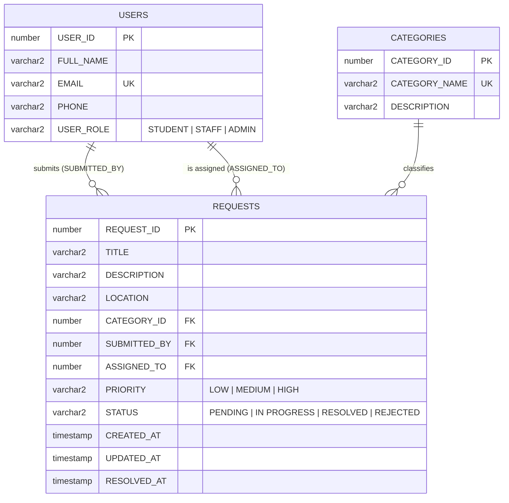
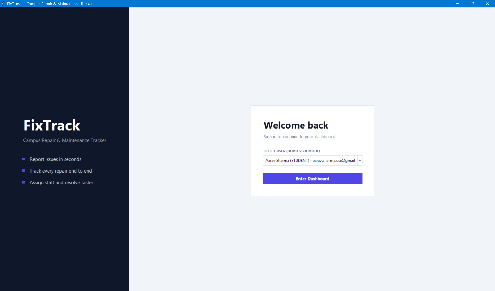
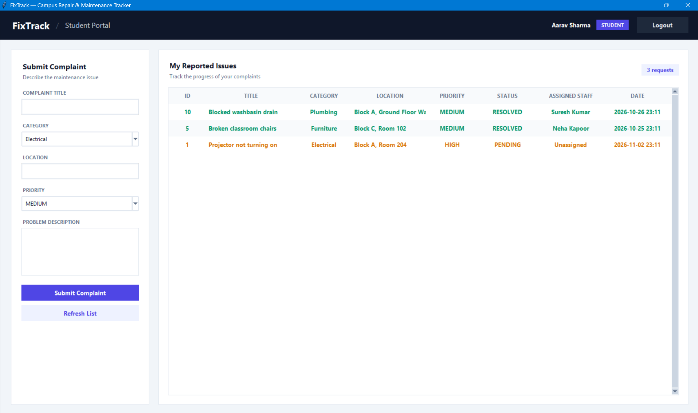
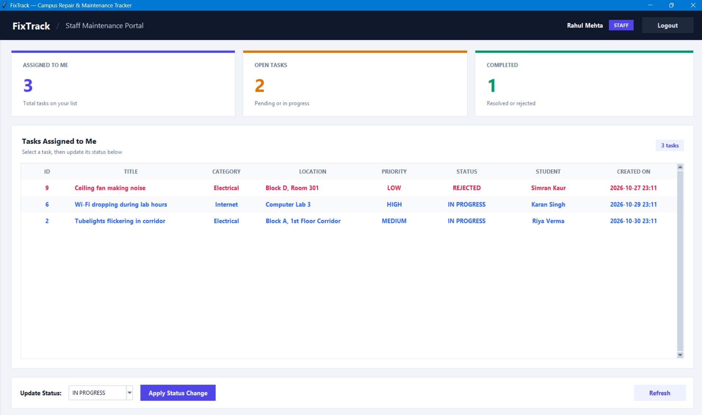
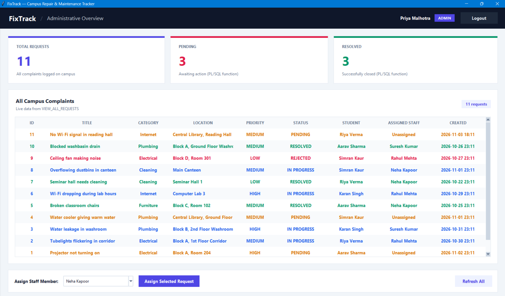

<div align="center">

# 🛠️ FixTrack

### Campus Repair & Maintenance Tracker

A role-based desktop application where students report campus issues, admins assign them to staff, and staff resolve them, all powered by an **Oracle PL/SQL backend**.


</div>

---

## 📖 About

**FixTrack** is a DBMS course project that digitizes the campus maintenance workflow. Instead of paper complaints and word-of-mouth, every issue is logged, assigned, tracked, and resolved in one place.

Business logic (submitting, assigning, status changes, statistics) lives **inside the database** as stored procedures and functions. The Python GUI is a thin client that calls them.

## ✨ Features

| Role | What they can do |
|---|---|
| 🎓 **Student** | Submit complaints with category, location, and priority. Track the status of their own requests. |
| 🔧 **Staff** | View tasks assigned to them, see open vs. completed counts, and update status to `IN PROGRESS`, `RESOLVED`, or `REJECTED`. |
| 🛡️ **Admin** | See campus-wide KPIs (Total / Pending / Resolved), browse all complaints, and assign requests to staff. |

**UI highlights**

- Modern split-screen login and a navy navigation bar with a role badge
- Card-based layout with KPI metric cards
- Zebra-striped tables with color-coded status labels
- Non-blocking toast notifications and smooth view transitions
- Hover and pressed states on all buttons

## 🧱 Tech Stack

- **Language:** Python 3.9+
- **GUI:** Tkinter / ttk (standard library, no extra installs)
- **Database:** Oracle Database 26ai Free (service `FREEPDB1`, port `1521`)
- **Driver:** [`python-oracledb`](https://python-oracledb.readthedocs.io/) in thin mode (no Oracle Client needed)

## 🏗️ Architecture

```
┌────────────────────┐        python-oracledb        ┌──────────────────────────────┐
│  Tkinter GUI       │  ───────────────────────────▶ │  Oracle Database (FIXTRACK)  │
│  (fixtrack_app.py) │                               │                              │
│                    │  ◀─────────────────────────── │  Tables · View · Procedures  │
└────────────────────┘          result sets          │  Functions · Trigger         │
                                                     └──────────────────────────────┘
```

### Database objects

| Type | Name | Purpose |
|---|---|---|
| Table | `USERS` | Students, staff, and admin with role check constraint |
| Table | `CATEGORIES` | Electrical, Plumbing, Furniture, Cleaning, Internet |
| Table | `REQUESTS` | Complaints with priority, status, assignee, and timestamps |
| View | `VIEW_ALL_REQUESTS` | Denormalized join of requests, categories, and users |
| Procedure | `SUBMIT_REQUEST` | Creates a new `PENDING` request and returns its ID |
| Procedure | `ASSIGN_REQUEST` | Assigns a request to a user, validating the `STAFF` role |
| Procedure | `UPDATE_REQUEST_STATUS` | Updates status and sets or clears `RESOLVED_AT` |
| Function | `GET_PENDING_COUNT` | Number of pending requests |
| Function | `GET_RESOLVED_COUNT` | Number of resolved requests |
| Trigger | `TRG_UPDATE_REQUEST_TIMESTAMP` | `BEFORE UPDATE` trigger that refreshes `UPDATED_AT` |

### ER diagram



### Request lifecycle

```
PENDING ──(admin assigns)──▶ IN PROGRESS ──(staff updates)──▶ RESOLVED
                                   │
                                   └────────(staff updates)──▶ REJECTED
```

## 📸 Screenshots

> Replace these with your own screenshots (put images in a `screenshots/` folder).

| Login | Student Portal |
|---|---|
|  |  |

| Staff Portal | Admin Dashboard |
|---|---|
|  |  |

## 🚀 Getting Started

### Prerequisites

- Python 3.9 or newer
- Oracle Database 26ai Free running locally
- An SQL client such as SQL Developer or SQL*Plus

### 1. Clone the repository

```bash
git clone https://github.com/misterprabhat/FixTrack.git
cd FixTrack
```

### 2. Install the Python driver

```bash
pip install oracledb
```

### 3. Set up the database

Run the scripts in this order.

| Order | Script | Run as |
|---|---|---|
| 1 | `01_create_user.sql` | A privileged user (`SYSTEM` or `SYS`) connected to `FREEPDB1` |
| 2 | `02_create_tables.sql` | `FIXTRACK` |
| 3 | `03_insert_sample_data.sql` | `FIXTRACK` |
| 4 | `04_setup_procedures_triggers_views.sql` | `FIXTRACK` (use **Run Script / F5**) |

### 4. Configure the connection

Open `fixtrack_app.py` and check `DB_CONFIG` near the top:

```python
DB_CONFIG = {
    "user": "FIXTRACK",
    "password": "your_password_here",
    "host": "localhost",
    "port": 1521,
    "service_name": "FREEPDB1"
}
```

> ⚠️ **Security note:** the password in this repository is for local demo use only. Never commit real credentials.

### 5. Run the app

```bash
python fixtrack_app.py
```

## 👥 Demo Accounts

The login screen lets you pick a user directly (demo mode).

| Role | Name | Email |
|---|---|---|
| 🎓 Student | Aarav Sharma | aarav.sharma.cse@gmail.com |
| 🎓 Student | Riya Verma | riya.verma.ece@gmail.com |
| 🎓 Student | Karan Singh | karan.singh.mech@gmail.com |
| 🎓 Student | Simran Kaur | simran.kaur.bba@gmail.com |
| 🔧 Staff | Rahul Mehta | rahul.mehta.electric@gmail.com |
| 🔧 Staff | Suresh Kumar | suresh.kumar.plumber@gmail.com |
| 🔧 Staff | Neha Kapoor | neha.kapoor.facility@gmail.com |
| 🛡️ Admin | Priya Malhotra | priya.malhotra.admin@gmail.com |

> The email addresses are fictional sample data. The app never sends email.

### Suggested demo flow

1. Log in as a **Student** and submit a new complaint.
2. Log in as **Admin** and assign it to a staff member. The status moves to `IN PROGRESS`.
3. Log in as that **Staff** member and mark it `RESOLVED`.
4. Return to **Admin** and watch the KPI cards update.

## 📁 Project Structure

```
FixTrack/
├── database/
│   ├── 01_create_user.sql
│   ├── 02_create_tables.sql
│   ├── 03_insert_sample_data.sql
│   ├── 04_insert_sample_requests.sql
│   ├── complete_database_setup.sql
│   ├── final_setup.sql
│   └── setup_all.sql
├── screenshots/
├── fixtrack_app.py
└── README.md
```

## 🔮 Future Improvements

- Real authentication with hashed passwords
- Filters and search on the tables
- Request comments and an activity history
- Email or SMS notifications when status changes
- Photo attachments for complaints
- Export reports to CSV or PDF

## 🎓 Concepts Demonstrated

`Primary / Foreign / Unique / Check constraints` · `Identity columns` · `Joins and views` · `Stored procedures` · `Functions` · `Row-level triggers` · `Exception handling with RAISE_APPLICATION_ERROR` · `Parameterized queries` · `Role-based access`

## 📄 License

This project is licensed under the [MIT License](LICENSE).

## 🙋 Author

**Prabhat Kumar**  
🎓 Chandigarh University · MCA · 2026  
🔗 [GitHub: @misterprabhat](https://github.com/misterprabhat)

<div align="center">

⭐ If you found this project useful, consider giving it a star!

</div>
